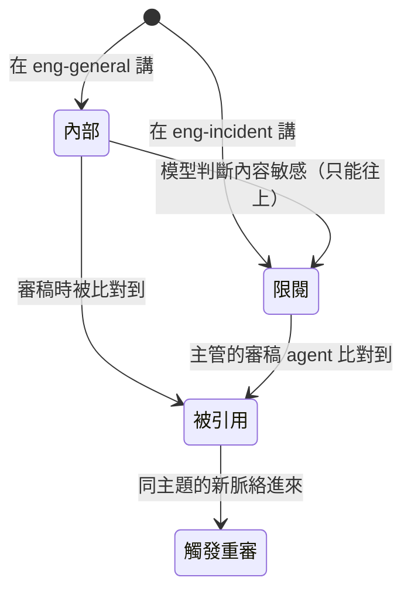
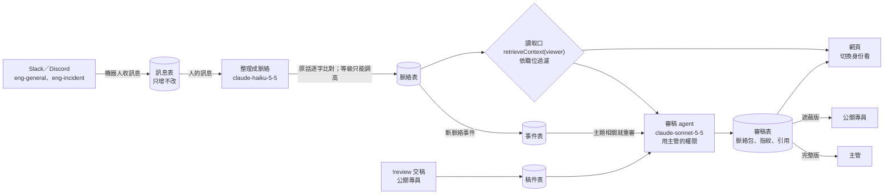
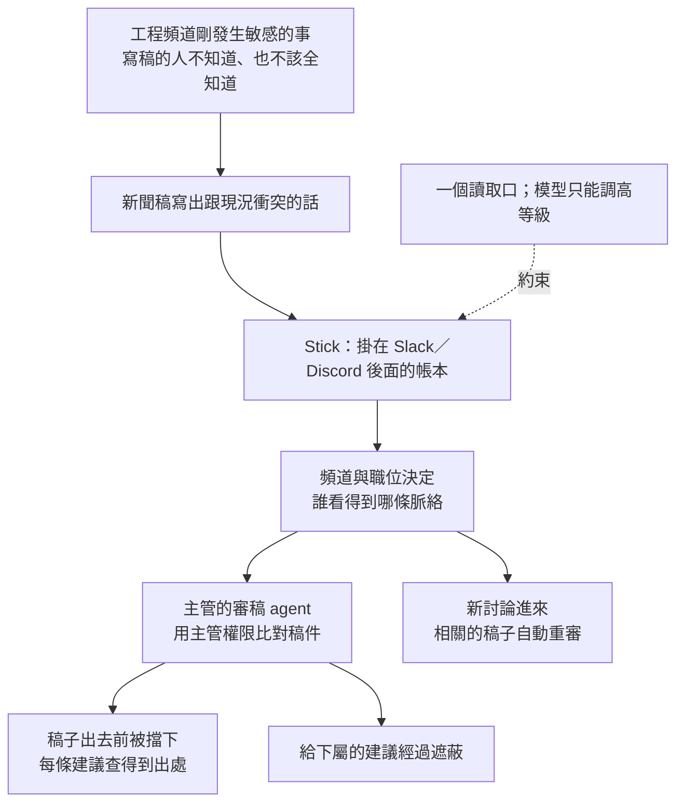

# Stick（公關審稿場景）— Product Intent & Mental Map

> 接上 Slack 或 Discord 就能用的團隊共用記憶。工程頻道剛討論出一件敏感的事，公關專員不知道，照樣寫了新聞稿；Stick 把最新脈絡依職位分級送到對的人手上，公關主管的審稿 agent 在稿子出去前比對最新討論，指出哪裡要改、依據是哪一句話，而且不把下屬無權看的內容洩露給下屬。

來源版本：`c0mpiled-18/stick`，branch `main` 的 `0f85b22`（文件階段，作品程式尚未開始）。
產出日期：2026-11-11 19:50（黑客松開發中，21:45 功能凍結）
狀態：**19:50 團隊改定場景**：由「客戶 API 當機、誰講的才算數」改為「公關審稿、依職位分級可見」。舊版見 `0f85b22`。
逐步清單與旁白：`docs/build-plan.md`；分工與進度：`docs/STATUS.md`

---

## 0. 產品意圖卡

| 欄位 | 內容 |
|---|---|
| 誰的問題 | 公司裡要對外發言的團隊：公關主管、公關專員，以及在內部頻道討論問題的工程、法務。工程頻道一有新狀況（延期、資安事件），寫稿的人往往最後才知道，或根本無權知道。 |
| 改變什麼 | 大家照常在 Slack／Discord 講話。Agent 自動把對話整理進資料庫並標上敏感等級；公關專員交稿時，主管的審稿 agent 用**主管的權限**拿到最新脈絡，比對稿件，產出「可以／要修改／先擋下」與修改建議，每一條附原訊息出處。 |
| 成功訊號 | 22:45 前交出 2 分鐘內影片與 GitHub 網址，影片每一步都是真的在跑。同一份有問題的稿子審 5 次：沒有 Stick 時 0 次抓到衝突；有 Stick 時至少 4 次兩個衝突都抓到。公關專員的畫面裡從沒出現限閱內容。 |
| 不做會怎樣 | 只做成「在 Slack 上搜尋」，跟 Glean 這類企業搜尋分不出來；也說明不了為什麼要分職位、為什麼要主動推給審稿的人。 |
| 邊界 | 不能壞：限閱內容不出現在無權者的任何畫面、脈絡包或審稿結果；模型只能把敏感等級調高、不能調低；每條建議引用的原話與原訊息逐字相符；紀錄只增不改。刻意不做：真的發新聞稿、帳號登入、手機版面、向量檢索。期限：21:45 凍結。 |

### 成功指標表

沒有上線流量，指標是開工前定好的驗收條件，只驗桌機 1280 寬。

| 層級 | 要回答的問題（商業意涵） | 指標＝分子 ÷ 分母（分裝置） | 口徑選項與本案採用 | 及格／好〔對標身份〕 |
|---|---|---|---|---|
| 交件 | 有沒有資格被評 | 22:45 前是否交出影片與公開的 repo 網址 | 影片 2 分鐘內 | 及格：交出〔主辦規則〕 |
| 核心 | 審稿 agent 有沒有抓到稿子與最新討論的衝突 | 兩個衝突都抓到的次數 ÷ 5 次（桌機） | 抓到＝結論不是 `ok`，且兩條問題分別引用了延期訊息與資安／法務訊息 | 及格 4/5，好 5/5〔自己：沒有 Stick 的對照組〕 |
| 權限 | 下屬看不看得到不該看的 | 限閱原話出現在公關專員畫面、脈絡包、審稿結果的次數 | 程式用字串比對所有限閱項目的原話 | 必須是 0〔必要邊界〕 |
| 出處 | 建議能不能回頭查 | 原話逐字相符的引用數 ÷ 引用總數 | 程式比對，不符就丟 | 100%〔必要邊界〕 |
| 重審 | 新討論進來，舊稿會不會被重新檢查 | 已過審的稿子在相關新訊息進來後被重審並改判的次數 ÷ 5 次 | 重審＝同一份稿子多一筆 `trigger = context_added` 的審稿 | 及格 4/5〔自己〕 |
| 分級 | 不同職位拿到的脈絡是否照規則不同 | 主管與專員的脈絡包差異是否剛好等於限閱項目 | 比對存下來的脈絡包 | 必須相符〔必要邊界〕 |

### 意圖追溯

| 意圖主張 | 使用者行為／成功訊號 | 支撐機制 | 架構／資料流位置 | 證據 |
|---|---|---|---|---|
| 接上就能用 | 邀一個機器人，不改工作方式 | 沿用頻道決定敏感等級下限、沿用帳號對照職位 | 收訊息 → 脈絡層 | 🟢 Discord 機器人 token 與讀訊息開關 18:39 驗過；🔵 Slack 未接 |
| 對的脈絡到對的人 | 主管看得到限閱、專員看不到 | 唯一的讀取口 `retrieveContext(viewer)` 依職位過濾 | 權限層 | 🟡 開工後以字串比對驗 |
| 稿子出去前先被擋 | 有問題的稿子審 5 次至少 4 次被抓到 | 審稿 agent 用主管權限拿脈絡、比對稿件 | 審稿層 | 🟡 開工後以 5 次重跑驗 |
| 每條建議有依據 | 點一條建議連回原訊息 | 引用逐字比對；審稿紀錄存脈絡包與指紋 | 審稿 → 網頁 | 🟡 開工後驗 |
| 情況變了會重審 | 新的工程訊息讓已過審的稿子重新被檢查 | 新脈絡事件比對稿件主題，觸發重審 | 事件表 → 審稿層 | 🟡 開工後驗 |

---

## 1. 一句話心智模型

Stick 是一本只增不改的帳本，掛在團隊的 Slack／Discord 後面：每句話記下誰講的、在哪講的，agent 把它整理成一條條帶敏感等級的脈絡。任何人的 agent 都只能透過同一個讀取口拿脈絡，讀取口照職位過濾；主管的審稿 agent 因此看得到下屬看不到的事，在稿子出去前把衝突指出來。代價是頻道要分清楚敏感等級，而且建議給下屬時要經過遮蔽。

## 2. 它是什麼

一個聊天機器人加一頁網頁。機器人負責收訊息、收稿（`!review`）、回覆審稿結果；網頁可以切換「以誰的身份看」，顯示脈絡、稿件、審稿結果與出處。

它不是：
- **企業搜尋**。搜尋是你問了才答；Stick 在有人交稿時，主動把相關的最新脈絡送到要簽核的人手上。
- **文法或品牌語氣檢查**。它不管文筆，只管「這份稿子跟公司內部最新發生的事有沒有衝突」。
- **共用提示詞**。提示詞沒有出處、不分權限，新討論進來不會自己觸發重審。

## 3. 解決什麼問題

| 問題 | 沒有它時 | 這個產品的回答 |
|---|---|---|
| 寫稿的人不知道工程剛發生什麼 | 新聞稿寫「明天上線」，工程昨天已決定延期 | 工程頻道的討論自動進脈絡，審稿時拿來比對 |
| 敏感的事不能讓所有人知道 | 要嘛告訴所有人（洩露），要嘛沒人提醒（出包） | 限閱內容只到主管的審稿 agent；給專員的建議會遮蔽 |
| 主管審稿靠記憶 | 主管忘了法務說「週五前不談資安」 | 每條建議附原訊息，主管點一下就確認 |
| 稿子過審後情況又變 | 舊稿照發 | 相關新訊息進來就重審，通知主管 |

## 4. 為什麼有效

### 4.1 權限是「能看到什麼」，由職位與頻道決定

因為團隊已經有頻道與職位，所以頻道決定一條脈絡的敏感等級下限（例如 `eng-incident` 一律限閱），職位決定能看到哪一級。換來的是不用另外設定；代價是規則粗，只有三級。

### 4.2 只有一個讀取口

因為權限一旦散在各處就一定會漏，所以審稿 agent、網頁、機器人都不直接查資料庫，只能呼叫 `retrieveContext(viewer)`。要驗權限，只要驗這一個函式。

### 4.3 模型只能調高敏感等級

因為判斷一句話敏不敏感，模型不一定可靠，所以頻道給下限，模型只能往上加（例如在一般頻道提到資安，模型標成限閱），不能往下減。模型判錯的後果是多藏一條，不會多洩露一條。

### 4.4 主管看完整版，下屬看遮蔽版

因為審稿用的是主管的權限，結果裡可能引用限閱內容，所以每條建議帶上它引用內容的最高敏感等級；專員的畫面只顯示他看得到的建議，其餘顯示「主管另有一項需要調整，會直接跟你談」。

### 4.5 查核不靠模型自己說

因為模型自稱引用了哪條不一定是真的，所以由程式比對引用的原話是否逐字存在，並用「沒有 Stick」的對照組證明差別。

## 5. 核心概念

承重概念是**一條脈絡的可見範圍**：它由兩件事決定（在哪個頻道講的、模型有沒有把它調高），不由問的人決定。理解這個，讀取口、遮蔽、審稿用誰的權限都推得出來。

| 詞 | 意思 |
|---|---|
| 記憶層 | 只增不改的表：訊息、脈絡、稿件、審稿、事件 |
| 脈絡 | 從一則或一串訊息整理出的一條摘要，帶主題、敏感等級、原話與出處 |
| 敏感等級 | `public`（可對外）、`internal`（內部）、`restricted`（限閱，只有主管級看得到） |
| 讀取口 | `retrieveContext(viewer)`，唯一拿脈絡的方式，照職位過濾 |
| 審稿 | 用主管的權限拿脈絡、比對稿件，產出結論、問題、修改建議與引用 |
| 重審 | 新脈絡的主題與稿件相關時，對已審過的稿子再審一次 |

## 6. 架構與資料流

這張圖最重要的是：所有拿脈絡的路都經過讀取口；模型出現兩次（整理脈絡、審稿），兩次都改不了誰能看到什麼。

怎麼開發，照資料流由左到右，三個人各一段，每一段可以單獨驗：

| 順序 | 做什麼 | 誰 | 檔案（建議） | 單獨驗的方法 |
|---|---|---|---|---|
| 1 | 機器人連線，收訊息印出來 | A | `src/bot.js`、`src/sources/discord.js` | 在頻道打一句，終端機看得到 |
| 2 | 表與寫入函式 | B | `src/db.js` | 測試：沒有改與刪的函式 |
| 3 | 訊息整理成脈絡，標敏感等級 | A | `src/ingest.js`、`config/channels.json` | 測試：非逐字原話被丟；等級不低於頻道下限 |
| 4 | 讀取口與職位對照 | B | `src/access.js`、`config/people.json` | 單元測試：每個職位 × 每個等級 |
| 5 | 審稿與遮蔽 | C | `src/review.js` | 腳本：有無 Stick 各 5 次 |
| 6 | 網頁 | C | `src/server.js`、`public/index.html` | 切換身份，專員畫面沒有限閱原話 |
| 7 | 新脈絡觸發重審 | A＋C | `src/ingest.js` 發事件、`src/review.js` 收事件 | 腳本：相關新訊息後 5 次 |

技術選擇：Node v24、discord.js（Slack 用 `@slack/web-api`，同一個 `sources/` 介面，下一步再接）、better-sqlite3、Anthropic 官方 SDK、原生 HTTP 伺服器加一頁靜態 HTML。不用前端框架，不用向量檢索（資料量小，過濾後整包帶入）。

## 7. 邊界、限制與取捨

| 類型 | 內容 | 緩解／復原 |
|---|---|---|
| 刻意不做 | 真的發新聞稿、帳號登入、手機版面 | 影片只演到「主管批准」；身份用網頁切換 |
| 刻意不做 | 向量檢索、圖片與錄音、Slack 以外的多個工作區 | 寫進 README 的下一步 |
| 已知限制 | 今晚 demo 只接 Discord，Slack 只做到同一個介面 | README 照實寫明；`sources/` 換一支就能接 |
| 已知限制 | 四個發言者裡至少兩個是 webhook 假扮 | README 照實寫明；誰是哪個職位由設定檔對照 |
| 已知限制 | 主題比對很粗，重審可能多觸發 | 寧可多審不漏審；README 寫明 |
| 必要邊界 | 限閱內容不給無權的人 | 只有一個讀取口；審稿結果依引用等級遮蔽；程式字串比對驗證 |
| 必要邊界 | 模型不能降低敏感等級 | 寫入時取 `max(頻道下限, 模型判斷)` |
| 必要邊界 | 紀錄只增不改 | 資料層不提供改與刪 |
| 必要邊界 | 金鑰不進 repo；repo 交件前才改公開 | `.gitignore` 已含 `.env`；改公開前先問 Felix |
| 接受的取捨 | 19:50 才改場景，少了 15 分鐘 | 重審預設只做「標記＋重跑」，不做通知主管的 DM |

## 8. 一張圖總結

**Mental shortcut：**聊天是原始紀錄；頻道和職位決定誰看得到；審稿用主管的眼睛看，結果用下屬的權限給。

## 9. 證據與來源

### 證據狀態

| 狀態 | 主張 | 來源／下一步 |
|---|---|---|
| 🟢 已驗證 | 作品 repo 19:21 建立，初始 commit 在開工之後 | `gh api repos/c0mpiled-18/stick/commits` |
| 🟢 已驗證 | Discord 機器人 token 有效、讀訊息內容的開關已開、已在伺服器 | Discord API 唯讀呼叫（18:39） |
| 🟢 已驗證 | 模型金鑰有效，`claude-haiku-5-5` 與 `claude-sonnet-5-5` 可呼叫 | 最小呼叫（16:27） |
| 🟡 假設 | 有 Stick 時，有問題的稿子審 5 次至少 4 次兩個衝突都抓到 | `scripts/compare.js` |
| 🟡 假設 | 沒有 Stick 時，審稿 agent 會說稿子沒問題 | 同一支腳本的對照組；若對照組也抓到，鏡 1 要改講法 |
| 🔵 未知 | 機器人能否讀到新開的 `eng-incident`、`pr-drafts` 兩個頻道 | 步驟 1 的第一個證據；不行就沿用 `一般`、`dev-process` |
| 🔵 未知 | Slack 何時接 | 今晚不接，列為下一步 |
| 🔵 未知 | 第三位隊友負責哪一塊 | 19:55 前當面講定 |

### 重要來源路徑

| 區域 | 路徑或 URL |
|---|---|
| 作品 repo | https://github.com/c0mpiled-18/stick |
| 逐步清單、旁白、資料格式 | `docs/build-plan.md` |
| 分工、交界、進度 | `docs/STATUS.md` |
| 舊場景（客戶 API 當機） | commit `0f85b22` 的 `docs/` |
