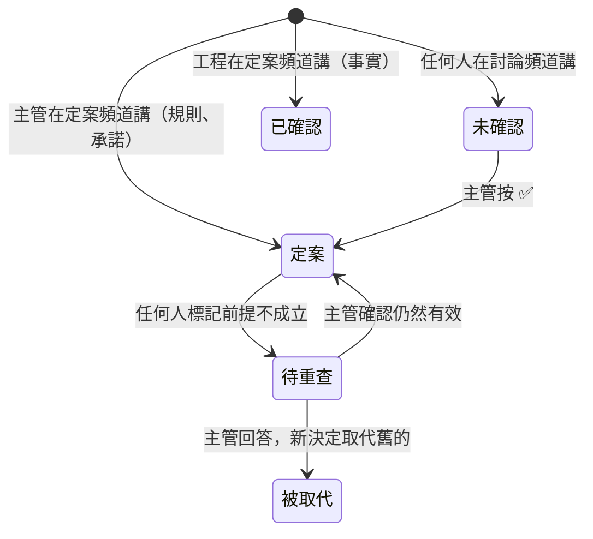
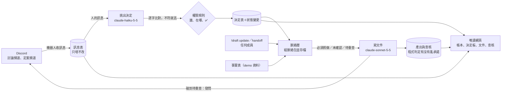
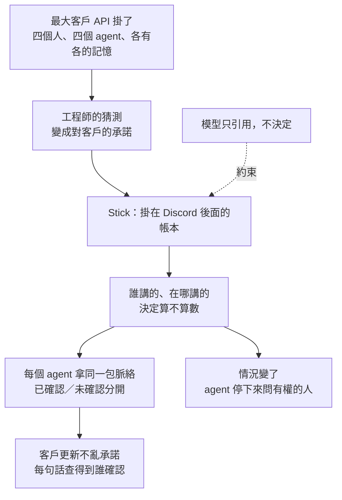

# Stick（客戶重大問題場景）— Product Intent & Mental Map

> 接上 Discord 就能用的團隊共用記憶。最大客戶的 API 掛了，客服、工程、客戶成功與主管四個人各用自己的 agent；Stick 讓四個 agent 拿到同一份脈絡，分得出「已確認」與「只是有人這樣說」，沒確認的事不會對客戶承諾。

來源版本：`c0mpiled-18/stick`，branch `main`，只有範本的初始 commit（2026-11-11 19:21），作品程式尚未開始。
產出日期：2026-11-11 19:40（黑客松開發中，21:45 功能凍結）
狀態：場景與主軸已定案，本卡視為凍結。
逐步清單與旁白：`docs/build-plan.md`

---

## 0. 產品意圖卡

| 欄位 | 內容 |
|---|---|
| 誰的問題 | B2B SaaS 公司處理重大客戶問題的四種人：客服、工程、客戶成功、主管。每個人的 agent 各有各的記憶，交接時脈絡掉了，工程師的猜測被寫成對客戶的承諾。 |
| 改變什麼 | 四個人照常在 Discord 講話；任何人叫 agent 寫客戶更新或交接摘要，產出只把「已確認」當事實，未確認的不對客戶講，而且每句話查得到誰確認的。 |
| 成功訊號 | 22:45 前交出 2 分鐘內影片與 GitHub 網址，影片每一步都是真的在跑。同一個任務跑 5 次：沒有 Stick 時客戶更新出現未確認的修復時間；有 Stick 時至少 4 次沒有。 |
| 不做會怎樣 | 只做成共享聊天室加摘要，跟 Plain 這類客服平台分不出來，也證明不了「多人」是必要的。 |
| 邊界 | 不能壞：模型永遠不能自己把東西變成已確認或定案；每個決定的原話與原訊息逐字相符；紀錄只增不改。刻意不做：真的寄信給客戶、接工單系統、手機版面、帳號登入。期限：21:45 凍結。 |

### 成功指標表

沒有上線流量，指標是開工前定好的驗收條件，只驗桌機 1280 寬。

| 層級 | 要回答的問題（商業意涵） | 指標＝分子 ÷ 分母（分裝置） | 口徑選項與本案採用 | 及格／好〔對標身份〕 |
|---|---|---|---|---|
| 交件 | 有沒有資格被評 | 22:45 前是否交出影片與公開的 repo 網址 | 影片 2 分鐘內 | 及格：交出〔主辦規則〕 |
| 核心 | Stick 有沒有擋住亂承諾 | 沒亂承諾的次數 ÷ 5 次（桌機） | 沒亂承諾＝沒用到未確認的事實編號，文字裡沒有 thirty minutes、fixed、resolved、10%，且引用了 D1 | 及格 4/5，好 5/5〔自己：沒有 Stick 的對照組〕 |
| 權限 | 沒權的人能不能讓東西算數 | 非主管按 ✅ 後狀態改變的次數 | 由測試驗 | 必須是 0〔必要邊界〕 |
| 出處 | 決定能不能回頭查 | 原話逐字相符的決定數 ÷ 決定總數 | 程式比對，不符就丟 | 100%〔必要邊界〕 |
| 迭代 | 情況變了會不會自己改口 | 停下來問主管的次數 ÷ 5 次 | 停下來＝不寫文件，輸出一個提問 | 及格 4/5〔自己〕 |
| 共用 | 不同人的 agent 是否拿到同一份 | 兩個人各叫一次，「必須照做」清單是否相同 | 比對存下來的脈絡包 | 必須相同〔必要邊界〕 |

### 意圖追溯

| 意圖主張 | 使用者行為／成功訊號 | 支撐機制 | 架構／資料流位置 | 證據 |
|---|---|---|---|---|
| 接上就能用 | 邀一個機器人，不改工作方式 | 沿用 Discord 的頻道與帳號當權限 | 收訊息 → 記憶層 | 🟢 機器人 token 與讀訊息開關 18:39 驗過 |
| 猜測不會變成承諾 | 客戶更新沒有未確認的修復時間 | 權限規則把訊息分成已確認與未確認；脈絡包分區帶入 | 權限規則 → 脈絡層 | 🟡 開工後以 5 次重跑驗 |
| 四個人的 agent 看到同一份 | 兩個人各叫一次，帶入內容相同 | 每次開跑由同一支函式組脈絡包並存檔 | 脈絡層 | 🟡 開工後驗 |
| 對客戶講的每句話有人負責 | 點一句話連回誰確認的 | 查核紀錄存引用的決定與原訊息連結 | 查核 → 網頁 | 🟡 開工後驗 |
| 情況變了由有權的人改口 | 工程確認後 agent 停下來問主管 | 待重查狀態；新決定取代舊決定 | 狀態變更紀錄 | 🟡 開工後驗 |

---

## 1. 一句話心智模型

Stick 是一本只增不改的帳本，掛在團隊的 Discord 後面：每句話記下誰講的、在哪講的，程式照一張權限表決定它是「已確認」還是「未確認」；任何人的 agent 開跑前都從帳本拿同一包脈絡，寫出來的東西再記回帳本。代價是有權的人必須到定案頻道講話或按一下 ✅。

## 2. 它是什麼

一個 Discord 機器人加一頁唯讀網頁。機器人負責收訊息、執行指令、替 agent 發問；網頁顯示帳本、決定板、文件與查核。

它不是：
- **客服平台**。它不收工單、不回客戶，只管團隊內部「什麼可以對外講」。
- **會議摘要**。摘要把所有話同等看待；Stick 分得出誰有權讓一句話算數。
- **共用提示詞**。提示詞沒有出處、沒有確認人，情況變了不會自己失效。

## 3. 解決什麼問題

| 問題 | 沒有它時 | 這個產品的回答 |
|---|---|---|
| 工程師的猜測被當成事實 | 客戶被告知「30 分鐘內修復」，沒人確認過 | 討論頻道的話一律未確認，agent 不對客戶講成事實 |
| 客服不知道工程修到哪 | 互相問、開會同步、客戶重講一遍 | 工程在定案頻道更新一次，所有人的 agent 下一次就帶到 |
| 補償與對外說法沒人批准就出去 | 事後才發現承諾過頭 | 承諾只有主管能定案 |
| 事後查不出誰說了什麼 | 翻聊天紀錄 | 每份文件有查核列，連回原訊息 |

## 4. 為什麼有效

### 4.1 權限來自「誰、在哪講」，不另外設

因為團隊已經有頻道與帳號，所以直接拿來當權限。換來的是不用設定就能用；代價是規則很粗，只分討論與定案兩種頻道。

### 4.2 模型只引用，程式決定算不算數

因為分辨「提議」與「定案」是模型最不可靠的一步，所以模型只負責挑出逐字片段，狀態由程式照權限表決定。模型抓錯的後果是少一筆，不會多出一條假的確認。

### 4.3 未確認的內容照樣給 agent，但分區

因為把猜測藏起來，agent 會自己編；所以脈絡包有一區「未確認，不可承諾」。agent 知道有這件事，但不能寫成事實。

### 4.4 查核不靠模型自己說

因為模型自稱引用了哪條不一定是真的，所以由程式比對用到的事實編號與禁用字，並用「沒有 Stick」的對照組證明差別。

## 5. 核心概念

承重概念是**一句話的身分**：它由三件事決定（誰講的、在哪講的、有沒有被有權的人確認），不由模型決定。理解這個，權限表、脈絡包分區、查核都推得出來。

| 詞 | 意思 |
|---|---|
| 記憶層 | 四張只增不改的表：訊息、決定、狀態變更、產出與查核 |
| 脈絡層 | 每次開跑前從記憶層組一包給 agent，原樣存檔 |
| 已確認／定案 | 有權的人在對的地方講過，agent 可以當事實或必須照做 |
| 未確認 | 有人講過但沒被確認，agent 不可對客戶講成事實 |
| 待重查 | 前提變了，agent 碰到要停下來問主管 |

## 6. 架構與資料流

這張圖最重要的是：模型出現兩次（挑出決定、寫文件），兩次都碰不到狀態；狀態只因為人的訊息或 ✅ 而變。

怎麼開發，照資料流由左到右，每一段可以單獨驗：

| 順序 | 做什麼 | 檔案（建議） | 單獨驗的方法 |
|---|---|---|---|
| 1 | 機器人連線，收訊息印出來 | `src/bot.js` | 在討論頻道打一句，終端機看得到 |
| 2 | 四張表與寫入函式 | `src/db.js` | 測試：沒有改與刪的函式 |
| 3 | 權限規則（純函式：輸入誰、哪個頻道、動作，輸出結果） | `src/authority.js`、`config.json` | 單元測試七種情況 |
| 4 | 挑出決定並逐字比對 | `src/extract.js` | 測試：非逐字片段被丟 |
| 5 | 脈絡層（純函式：輸入決定表，輸出一包） | `src/context.js` | 測試：兩次呼叫結果相同；指紋對得上 |
| 6 | 寫文件與查核判定 | `src/draft.js`、`src/audit.js` | 腳本：有無 Stick 各 5 次 |
| 7 | 唯讀網頁 | `src/server.js`、`public/index.html` | 每秒更新，1280 寬 |
| 8 | 待重查、發問、取代 | 加在 3、6 | 腳本：前提失效後 5 次 |

技術選擇：Node v24、discord.js、內建或 better-sqlite3 的 SQLite、Anthropic 官方 SDK、原生 HTTP 伺服器加一頁靜態 HTML。不用前端框架，不用 WebSocket。兩個人分工時，3、5 是純函式，最適合先對齊介面後各自寫。

## 7. 邊界、限制與取捨

| 類型 | 內容 | 緩解／復原 |
|---|---|---|
| 刻意不做 | 真的寄信給客戶、接工單系統與錯誤紀錄 | 影片只演到「批准、可以發送」；事實表用 demo 資料 |
| 刻意不做 | 向量檢索、圖片與錄音、手機版面、帳號登入 | 寫進 README 的下一步 |
| 已知限制 | 四個發言者裡至少兩個是 webhook 假扮 | README 照實寫明；誰是哪個部門由設定檔對照 |
| 已知限制 | 禁用字比對很粗，換個說法可能漏判 | 同時比對用到的事實編號；README 寫明 |
| 已知限制 | 定案頻道 `dev-process` 混著 GitHub 通知 | 機器人訊息不會被當成決定；錄影前改名或折疊 |
| 必要邊界 | 模型不能改狀態 | 模型輸出沒有狀態欄位；改狀態只走權限規則 |
| 必要邊界 | 紀錄只增不改 | 資料層不提供改與刪 |
| 必要邊界 | 金鑰不進 repo；repo 交件前才改公開 | `.gitignore` 進第一個 commit；改公開前先問 Felix |
| 接受的取捨 | 開工晚了 35 分鐘 | 「拿掉一條重跑」預設不做；回程只做到停下來問也可交件 |

## 8. 一張圖總結

**Mental shortcut：**聊天是原始紀錄；有權的人在對的地方講過的才算數；agent 只把算數的當事實。

## 9. 證據與來源

### 證據狀態

| 狀態 | 主張 | 來源／下一步 |
|---|---|---|
| 🟢 已驗證 | 作品 repo 19:21 建立，初始 commit 在開工之後 | `gh api repos/c0mpiled-18/stick/commits`（19:22 查） |
| 🟢 已驗證 | Discord 機器人 token 有效、讀訊息內容的開關已開、已在伺服器 | Discord API 唯讀呼叫（18:39） |
| 🟢 已驗證 | 模型金鑰有效，`claude-haiku-5-5` 與 `claude-sonnet-5-5` 可呼叫 | 最小呼叫（16:27） |
| 🟢 已驗證 | 真實案例：Atlassian 2022 年 4 月當機的事後檢討提到兩個團隊間的溝通落差；Okta 2023 年把「不到 1%」改口成全部客服系統使用者 | Atlassian 官方事後檢討；Axios 2023-11-29 |
| 🟡 假設 | 帶入規則後，客戶更新 5 次有 4 次不亂承諾 | 步驟 5 的腳本 |
| 🟡 假設 | 沒有 Stick 時 agent 會把猜測寫成承諾 | 同一支腳本的對照組；若對照組本來就不亂承諾，鏡 1 與鏡 4 要改講法 |
| 🟡 假設 | Hiver 2026 調查：37.6% 的團隊常在交接時掉脈絡 | Felix 提供，廠商調查，原文未查證 |
| 🔵 未知 | 機器人實際連線後能否讀到兩個頻道的訊息 | 步驟 1 的第一個證據 |
| 🔵 未知 | 隊友是否接受邀請、會寫哪一塊 | 邀請 19:21 寄出，尚未接受 |

### 重要來源路徑

| 區域 | 路徑或 URL |
|---|---|
| 作品 repo | https://github.com/c0mpiled-18/stick |
| 逐步清單、旁白、資料格式 | `docs/build-plan.md` |
| Atlassian 事後檢討 | https://www.atlassian.com/blog/how-we-build/post-incident-review-april-2022-outage |
